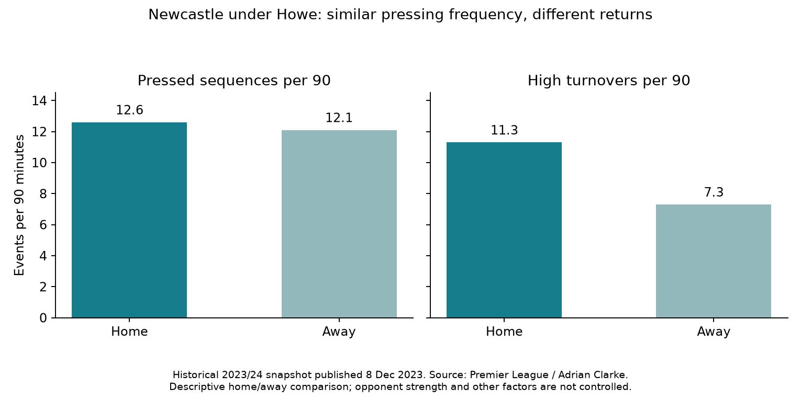
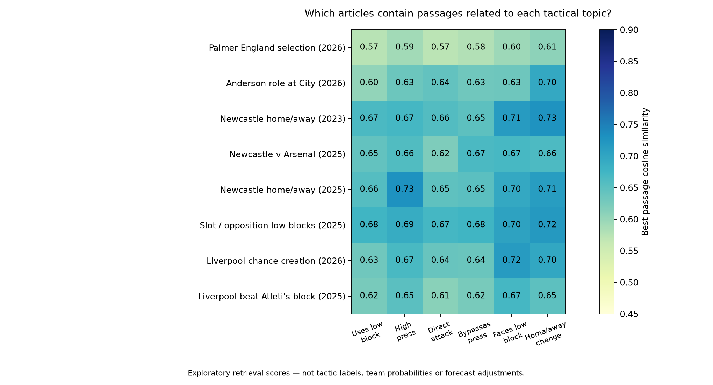

**The most useful sources in this experiment were PremierLeague.com's tactical analysis, Sky Sports reporting and UEFA's detailed match analysis.** BBC remains a useful supplementary source when a particular article explains tactics or player roles. We decided against a paid news provider for this stage.

The purpose is to find information that could improve match and player predictions: which teams defend deep, when they press aggressively, how they adapt to particular opponents, and which players gain or lose attacking opportunities as a result. Injuries are outside this news experiment because our existing FPL data already supplies availability information.

The first tests confirmed that free article retrieval and local semantic search are practical. They also showed that finding similar language is easier than correctly identifying who used a tactic. We have evidence worth developing into predictive features, but have not yet demonstrated better forecasts.

## The question we actually wanted to answer

Consider Liverpool facing a team likely to defend in a low block. If that Liverpool side struggles to create good chances against deep defences, the matchup might affect its goal expectation. That is a testable interaction between two playing styles.

Or consider Newcastle under Eddie Howe at St James' Park. An aggressive press might create turnovers and opportunities for attackers. The same team away from home, or against an opponent comfortable playing through pressure, might behave differently.

Those examples suggest the information we need:

| Information to look for | Potential use in a prediction |
| --- | --- |
| Defensive height and compactness: low block, mid-block or high line | Describe the space an opponent allows and the attacking problems it presents |
| Pressing approach and effectiveness | Identify turnover opportunities and exposure when a press is beaten |
| Direct play, transitions and counterattacks | Describe how a team is likely to create chances |
| Ability or difficulty playing through a press or deep defence | Represent a specific tactical matchup |
| Changes by venue, opponent, manager or match situation | Avoid assigning one permanent style to a club |
| Player role and attacking responsibility | Connect a team approach to individual shot, goal or assist opportunities |

These are candidate features. Their direction and size must be learned from data rather than assigned from a convincing narrative.

## How we narrowed the search

We began with a Sky Premier League RSS feed and a broader BBC football feed. Together, their snapshots supplied 95 entries. A basic headline-and-summary filter found 13 BBC matches and no Sky matches, but it was looking for broad terms such as squad, injury, preview and return.

That filter was poorly aligned with the task. England selection reporting passed, while a manually selected Sky article contained useful attacking commentary despite failing the filter. More matching headlines would not necessarily mean more predictive information.

We changed the selection criteria to tactical questions: **who defends deep, who presses, how they attack, how opponents adapt, and what changes at home or away?** We then researched five specific articles about Liverpool's low-block encounters and Newcastle's pressing and opponent-specific adaptations.

All five could be retrieved and processed locally, giving us eight saved articles in total. This was a deliberately selected exploratory sample, not a measurement of each publisher's overall coverage.

For a continuing collection, RSS is one discovery channel. The tactical sample shows why we should also target analysis sections and specific team-and-tactic searches. Candidate searches include `Newcastle home away pressing`, `Liverpool opponents low block`, and `Newcastle Arsenal tactical analysis`. Those are examples of the narrower search we tested manually, not an automated discovery service we have already deployed.

## Which sources we settled on

| Source | Role in our collection | Reason for the choice |
| --- | --- | --- |
| **PremierLeague.com tactical analysis** | Primary starting point | The selected articles connected tactical descriptions to opponents, venue and supporting statistics. This was the closest fit to our prediction questions. |
| **Sky Sports** | Supporting reporting and manager comments | Provides statements about tactical problems, opposition approaches and intended changes. We need to distinguish a manager's explanation from independently measured performance. |
| **UEFA technical match analysis** | Detailed examples and counter-evidence | Explains how particular tactical encounters worked, including successful responses to low blocks. European examples need their competition context preserved. |
| **BBC Sport** | Targeted supplement | Some articles contain useful player-role analysis; the broad football feed also supplied material outside our tactical scope. Select the article rather than accepting the entire feed. |

This is a source shortlist for the next experiment. It is based on the material we inspected, not a comprehensive quality ranking. We have not established continuous coverage of every club or fixture.

### Useful articles to inspect

- [Premier League: Newcastle's home-versus-away pressing, December 2023](https://www.premierleague.com/en/news/3814250). A useful historical example combining tactical explanation and measurable differences.
- [Premier League: Newcastle's adaptations against Arsenal, May 2025](https://www.premierleague.com/en/news/4309775/analysis-arsnew). Describes deeper defending and more direct play against a specific opponent, despite the team's usual pressing identity.
- [Premier League: Newcastle's away difficulties, November 2025](https://www.premierleague.com/en/news/4455877/why-are-newcastle-struggling-away-from-home). Connects venue to pressing structure and attacking output.
- [Sky: Slot on opponents' low blocks and long balls, October 2025](https://www.skysports.com/football/news/13456544/arne-slot-liverpool-must-find-a-way-to-cope-with-opponents-low-block-and-long-balls-tactics-amid-premier-league-slump). Identifies opposition approaches and attempted adaptations. The team using the low block is the opponent, not Liverpool.
- [UEFA: Liverpool overcoming Atletico's low block, September 2025](https://www.uefa.com/uefachampionsleague/news/029d-1ec0f6abc563-d1255d1332f9-1000--in-the-zone-how-liverpool-bypassed-atleti-s-low-block/). Important counter-evidence: a reported weakness should not become an assumption that Liverpool always struggle.

### Examples we would exclude or use differently

[BBC's Palmer England-selection article](https://www.bbc.co.uk/sport/football/articles/c9e8ll62rp68o) is a poor input for club tactical matchups. It discusses a different selection context and does not identify a club opponent's defensive plan.

[BBC's Anderson profile](https://www.bbc.co.uk/sport/football/articles/cqde8w0k2pz1o) is more useful for a player-role feature than for predicting a low block. That distinction matters: an article can be useful for one feature and unsuitable for another.

[Sky's later Liverpool chance-creation article](https://www.skysports.com/football/news/13608882/liverpool-andoni-iraola-demands-creativity-over-control-to-solve-premier-league-scoring-problems) contains attacking context, but its retrieved passage did not establish a low-block matchup. Its different manager and time period also make it unsuitable evidence for a Slot-era profile.

## What Newcastle's home and away comparison tells us



The [December 2023 Premier League analysis](https://www.premierleague.com/en/news/3814250) reported 12.6 pressed sequences per 90 at home versus 12.1 away, but 11.3 high turnovers versus 7.3. Similar pressing frequency produced different returns.

This is descriptive evidence from that historical sample, without adjustment for opponent strength. It shows why we should record both pressing intent and effectiveness. It also shows why a single “high-press team” category would lose information relevant to a particular fixture.

The [Arsenal analysis](https://www.premierleague.com/en/news/4309775/analysis-arsnew) adds a second lesson: Newcastle could deliberately adopt a deeper defensive approach and more direct passing for an opponent. Team, manager, venue and opponent belong together in the record.

## Where vector search helped—and where it failed

We divided the eight article bodies into 106 overlapping passages and generated embeddings locally. DuckDB ranked passages against six tactical questions covering low-block defending, pressing, direct attacks, bypassing presses, facing low blocks and home/away differences.

The strongest high-press result retrieved Newcastle's pressing comparison. The home/away query also found a relevant Newcastle analysis. However, the low-block-use query retrieved Slot describing opposition defences. Another query ranked general chance-creation commentary above an explicit low-block report.

Vector search therefore helped locate candidate evidence, but did not reliably establish the tactical claim. The next step is to identify the actor, opponent, context and supporting statement. A formation alone is also insufficient: a 5-4-1 shape does not tell us how high the team defends.

<details>
<summary>View the exploratory retrieval scores</summary>



The scores show related language. They are not probabilities of a tactic, automatic team labels, or forecast adjustments. The overlap between relevant and misleading matches is part of the result.

</details>

## Turning reporting into predictive information

The record we want is an evidence-backed tactical claim with a source URL, publication time, match or period described, team, opponent, manager, venue and whether it is an observation or prediction.

For example, Newcastle defending deeper against Arsenal is an opponent-specific observation. Liverpool encountering a low block describes an opposition tactic. Those claims should remain separate when grouping similar tactical evidence.

The proposed prediction flow is:

```text
Relevant article passage
    → verified tactical claim and context
    → likely team approach for a future fixture
    → interaction with the opponent's attacking or defensive profile
    → test against baseline goal and player-performance predictions
```

We have tested retrieval; automatic claim extraction and the prediction steps remain future work. Only information available before kickoff should enter a forecast. Manager changes and historical publication dates need careful handling, including pages whose embedded tables may have been updated later.

We would then test whether tactical features add information beyond existing team strength, recent performance and home advantage. Any effect on player forecasts should reflect that player's role and expected opportunities rather than apply an equal reduction to every player.

## Keeping the experiment free and repeatable

The prototype used Python, [dlt with DuckDB](https://dlthub.com/docs/dlt-ecosystem/destinations/duckdb), local text extraction and local embeddings. No paid news API, hosted inference or BigQuery jobs were used. Raw responses and vectors were cached so parser and search changes could be replayed without fetching articles again.

Article requests required an explicit allowance, with a maximum of five new attempts per run and a default of ten per UTC day. Previously attempted normalized URLs were skipped, including failed requests. This controls repeated fetching, but deliberately misses later edits to an already fetched page. Checking robots.txt did not establish full-text processing or redistribution rights, which remain a production requirement to resolve.

## Findings and source decision

**We settled on PremierLeague.com tactical analysis as the primary starting point, Sky Sports as supporting reporting, UEFA for detailed match examples, and BBC as a selective supplement.** A paid news aggregator is unnecessary for the next stage of this experiment.

**We narrowed the search from general football news to contextual tactical evidence:** defensive blocks, pressing, direct play, responses to opposing systems, venue-specific changes and player roles. Injury news, transfer gossip and selection controversy do not meet this tactical brief merely because they mention a relevant player.

**The useful unit is a tactical claim attached to a team, opponent, manager and time—not an entire article assigned to a permanent club style.** Vector search can propose passages for that process, but correct attribution and supporting evidence need validation.

The next experiment should label a small, varied set of these claims and test retrieval and attribution before evaluating their contribution to forecasts. We now have useful sources and a clearer selection brief; we have not yet shown a predictive improvement.
